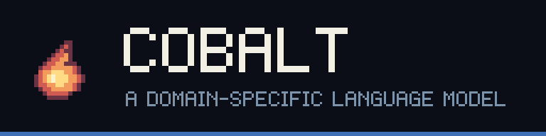
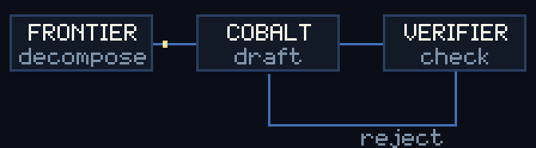

<div align="center">



### A domain-specific language model for Python, verified by tests rather than trusted.

[](https://github.com/anubhavaanand/project-cobalt-dslm/actions)
[](pyproject.toml)
[](dslm/config.py)
[](LICENSE)

</div>

---

##  The idea

Frontier models are expensive because they are general. Cobalt asks what happens
if they don't have to be.

> If a task is narrow enough to be machine-verifiable, does a small model plus
> free retries beat an expensive model on cost and latency at comparable quality?

The answer is probably yes, and the reason is arithmetic.

##  The math that makes it work

If one attempt succeeds with probability `p`, then `n` free retries succeed with
probability `1 − (1−p)^n`:

| per-try `p` | success in 100 tries |
|:-----------:|:--------------------:|
| 0.20 | 99.99999998% |
| 0.10 | 99.997% |
| **0.05** | **99.4%** |
| 0.01 | 63.4% |

A model with **5% per-attempt accuracy is functionally perfect** given free
retries. The requirement changes from *"be as good as the frontier"* to *"have a
non-trivial chance of being right"* — which is a far more achievable target.

##  What it produces today

Real output, 150 training steps, no cherry-picking:

> Once upon a time to the when a to her to the! He was so new.
> " mom was a strange that he was been time. He was very friends
> were safe!" She was very proud and he was very special.

Grammar: mostly there. Meaning: absent. That gap is what 20 tokens-per-parameter
of the right data is supposed to close, and it is the entire point of Phases 1–3.

##  How it works



The frontier model decomposes the task and writes test cases. Cobalt drafts each
unit. The verifier accepts or rejects — and a rejection is what drives the next
attempt. The model never plans. It executes.

**Cobalt is a component, not a product.**

---

##  Presets

| Preset | Params | Tokens | Time | Purpose |
|---|---:|---:|---|---|
| `smoke` | 13.8M | 5M | seconds | does the pipeline connect? |
| `kaggle` | 35.5M | 295M | ~2 h | ablation workhorse |
| `base` | 122.7M | 1.97B | ~30 h | the real model |

Each preset's token budget is asserted in CI. An earlier version shipped one that
was 30× undertrained and would have looked like an architecture failure rather
than a config error.

##  Verified

| Check | Result |
|---|---|
| forward + backward | finite loss and gradients |
| tokenizer | round-trips; every byte representable |
| data prep | 4.27M tokens, 4.20 bytes/token |
| train loop | loss 9.11 → 4.11, ~85,000 tok/s on a T4 |
| checkpoint / resume | weights, optimizer state, and step |
| test suite | 40 passed, CI on 3.11 and 3.12 |

##  Layout

```
dslm/
  config.py      model + training presets
  model.py       the transformer: RMSNorm · RoPE · SwiGLU · weight tying
  data.py        memory-mapped uint16 token streams
  tokenizer.py   byte-level BPE — no OOV, so code always round-trips
  train.py       pretraining loop, with checkpoint/resume
  sample.py      generation
scripts/         data preparation, notebook generator
notebooks/       Cobalt_Phase0.ipynb — 15 cells, runs on Kaggle
tests/           40 tests
```

##  Status

**Phase 0 — pipeline bring-up.** Verified end to end on Kaggle 2×T4. Not yet
trained at scale.

##  Scope

Cobalt works when correctness is machine-checkable. It breaks when:

- the tests encode the wrong behaviour — *the #1 failure mode*
- the task needs cross-file or global reasoning
- the task needs a novel algorithm
- the edit chain is long and dependent

**A repo with no tests is outside its competence, no matter how good the model
is.** That is a scope statement, not a limitation to hide.

Two constraints from the literature shape the design:

- **Single-shot only.** Multi-turn tool use collapses below 1B params (TinyLLM).
  No conversation, no memory — the harness holds all state.
- **The decomposer must be a frontier model.** Decomposition prompts do not
  generalise across domains (Least-to-Most).

##  Prior work

The test-input selection idea is structurally close to **CodeT**
([arXiv:2207.10397](https://arxiv.org/abs/2207.10397)), which generates programs
and tests jointly and selects by dual execution agreement.

The difference: CodeT selects among generated *programs*; Cobalt selects among
the model's own function *repertoire*. That difference is the contribution and the
risk — CodeT's assumption that *incorrect solutions rarely agree* is unproven for
*incorrect functions*.

##  Rights

**Proprietary. All rights reserved.** See [LICENSE](LICENSE).

Public so you can read it. Not open source — no permission to copy, modify,
redistribute, use commercially, or train a competing model. Publication for
visibility is not a grant of rights.